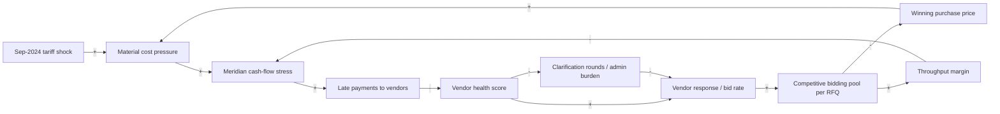
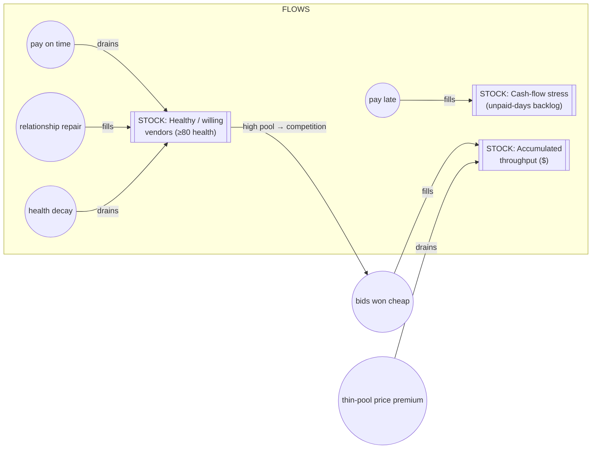

# From Problem to Agent

### The Meridian Industrial Systems Field Book

*A workshop in diagnosing a real supply-chain crisis with data, then building the AI agents that would have prevented it.*

> **A note on the numbers.** Every figure in this book was computed directly from the dataset in `output_v2/` (pre-constraint = months 0–7, Jan–Aug 2024; constraint period = months 8–17, Sep 2024–Jun 2025). They are reproduced here so you can check your own work against them. If your analysis lands close to these, you've done it right; if it's wildly different, re-read your aggregation logic before your conclusions.

---

## Preface

This book is built around a single company that does not exist.

**Meridian Industrial Systems** manufactures CNC machines and robotic assembly cells. Eighteen months of its procurement life — January 2024 through June 2025 — have been reconstructed in synthetic detail: every vendor, every request-for-quote, every bid, every late payment, every clarification email, every price tick on the commodities it buys. Twenty-four CSV files, over four thousand email threads, a complete event log.

Somewhere in late 2024, Meridian broke. Deliveries slipped. Purchase prices crept up. The procurement team worked harder and harder and felt they were falling behind. And — this is the important part — *nobody could name the cause.* Everything that was individually measured looked more-or-less fine. The failure lived in the relationships *between* the measurements.

That is the whole point of this book. Real operational failures are rarely a single broken gauge. They are a **cascade**: a shock enters the system at one point, and the damage surfaces somewhere else entirely, weeks later, wearing a disguise. The gap between where it hurts and where it *started* is exactly where good diagnosis — and good AI — earns its keep.

The book has two movements:

1. **Diagnosis** — You use eighteen months of data to find the constraint and put a dollar figure on it. This is systems thinking with a spreadsheet: Theory of Constraints and Throughput Accounting applied to numbers that fight back.
2. **Agency** — You build the AI agents that would have caught it. Monitoring agents, planning agents, forecasting models, and a fast triage layer — and, crucially, you learn *which kind of intelligence each job actually needs.*

You will not be told the answer up front. The data has surprises in it, deliberately. Things that look like the constraint are usually symptoms. Trust the numbers over your intuitions.

---

## Part I — The Scenario

### Who is Meridian

Meridian buys from **24 vendors** across the world, grouped into a handful of categories — Mechanical Parts, Electrical Components, Raw Materials, and so on. Each vendor is a character with a behavioral archetype and a *relationship arc*: some are `stable`, some `improving`, some `declining`, some newly onboarded and still `new_proving`.

A few you will come to know well:

| Vendor | Country | Category | Arc | Why they matter |
|---|---|---|---|---|
| **Kovacs Precision GmbH** (V001) | Germany | Mechanical Parts | `declining` | A nine-year, reliable partner on `Net60` terms — the kind of vendor you don't notice until they wobble. |
| **Tanaka Electrical KK** (V002) | Japan | Electrical Components | `stable` | The dependable anchor of the electrical pool. |
| **Patel Alloys Pvt Ltd** (V003) | India | Raw Materials | `improving` | A relationship-focused supplier climbing the health rankings — the one worth locking in early. |

These are not decorations. The whole crisis is a story about *relationships* degrading, and you will trace it vendor by vendor.

### The causal chain

The dataset's own generator leaves a note — a spoiler the workshop asks you to *prove* rather than accept:

> *"Sep 2024 tariff shock → Meridian cash-flow stress → late payments → vendor health scores drop → response rates fall → RFQ pool shrinks → procurement has to work harder → constraint becomes visible."*

Read that chain carefully. The shock is a **tariff** (external, exogenous, in the market-signals data). The pain shows up as **an exhausted procurement team and higher prices** — three or four links downstream. If you only looked at the pain, you would try to fix the team's workload or renegotiate prices, and you would fail, because neither is the constraint. The constraint is a *collapse in the number of vendors who still bother to bid.*

A second shock lands in **April 2025**: a rare-earth / neodymium-magnet price spike. By then the system is still fragile, and the Oracle challenge asks whether you could have seen it coming.

### The data at a glance

Everything lives in `output_v2/` as 24 CSVs keyed by `month_index` (0 = Jan 2024 … 17 = Jun 2025).

| File | Rows | What it holds |
|---|---|---|
| `01_vendors.csv` | 24 | The cast — archetypes, risk tiers, relationship arcs, payment terms |
| `02_vendor_performance.csv` | 416 | Monthly KPI snapshots per vendor |
| `03_commodity_prices.csv` | 790 | Weekly prices + `shock_flag` for steel, copper, rare earths |
| `04_market_signals.csv` | 18 | Tariffs and capacity announcements — the exogenous events |
| `05_sales_orders.csv` | 225 | Customer revenue (the **R** in Throughput) |
| `07_work_orders.csv` | 202 | Internal work orders — each triggers an RFQ |
| `09_rfq_events.csv` | 202 | RFQ issue dates, deadlines, cycle times, invite counts |
| `10_rfq_vendor_invites.csv` | 1,424 | Who was invited and whether they responded |
| `12_bids.csv` | 1,120 | Actual bids — the real measure of competition |
| `13_bid_evaluation.csv` | 1,120 | Scored, ranked bids |
| `14_purchase_orders.csv` | 202 | Winning bids → POs (the **TVC** in Throughput) |
| `16_vendor_disputes.csv` | 9 | Late-delivery and quality disputes |
| `20_payment_events.csv` | 202 | Meridian's own payment behavior — `days_late` |
| `22_rfq_admin_burden.csv` | 1,424 | Clarification rounds per RFQ |
| `23_vendor_health_scores.csv` | 416 | Monthly composite health, `trend_3mo`, `alert_flag` |
| `24_event_log.csv` | 4,466 | The complete timeline, everything in order |

The volume matters. Over 4,000 email threads and 4,400 log events is more than a human can read — which is the setup for the agent half of the book.

---

## Part II — The Diagnosis

Before you build anything, you have to *understand*. Two challenges, no API key required, pure analysis. But before either one, a prior question: **why did the crisis persist and accelerate** instead of self-correcting? For that you need to see the *structure* — the feedback loops and the accumulations — not just the monthly numbers. Chapter 0 draws the system; Chapters 1 and 2 then put a bottleneck and a dollar figure on it.

### Chapter 0 — The Shape of the Crisis (System Dynamics)

A monthly table tells you *what* changed. It does not tell you *why the change fed on itself.* Meridian's crisis was not a one-time hit that the system absorbed — it was a **vicious circle** that a tariff shock kicked into motion and that then ran under its own power. Two systems-thinking lenses make that visible: a **Causal Loop Diagram** (the feedback structure) and a **Stock & Flow** map (where things pile up and drain).

#### Lens 1 — Causal Loop Diagram: *why it persisted*



Signed edges: `+` = both move the same way, `-` = they move opposite. To classify a loop, **count the minus signs — even → reinforcing (R, a vicious or virtuous circle), odd → balancing (B, self-correcting).**

- **R1 — The margin death spiral (the dominant loop).** `CASH → + LATE → − HEALTH → + RESP → + POOL → + MARGIN → − CASH`. Two minus signs → **reinforcing**. Cash stress makes Meridian pay late; late payment erodes vendor health; unhealthy vendors stop bidding; a thin pool loses price competition; margin falls; falling margin *deepens* cash stress. This is the loop that turned a one-month tariff into a ten-month decline. The data signature is unmistakable: bids/RFQ **6.40 → 4.50 (−30%)**, T-margin **20.0% → 16.4%**.
- **R2 — The price-cost ratchet.** `POOL → − PRICE → + COST → + CASH → + LATE → − HEALTH → + RESP → + POOL`. Four minus signs → **reinforcing**. A thin pool raises the winning price, which *is* material cost, which feeds the same cash stress that thinned the pool. The tariff didn't need to stay elevated; the pool shrinkage kept prices high on its own.
- **B1 — Admin firefighting (a weak balancer).** `HEALTH → − CLAR → − RESP → + POOL → + MARGIN → − CASH → + LATE → − HEALTH`. Three minus signs → **balancing**, but it balances the *wrong way*: as health drops, clarification rounds rise (specs get queried, bids get chased), which further *suppresses* response. What should relieve the system instead loads it. Admin burden isn't the disease; it's the fever. (Note the data: clarification rounds barely move, 3.37 → 3.62 — the team worked harder per round, which is why they felt exhausted while the metric looked flat.)
- **B2 — The response-rate governor (too slow to help).** `HEALTH → + RESP → + POOL → + MARGIN → − CASH → + LATE → − HEALTH`. One minus sign → **balancing**: in principle, if health recovers, response recovers and the loop damps. It exists — late 2024's partial recovery rides it — but it is **out-run by R1/R2** because of delay.

**The delays are the whole story.** Health scores are a `trend_3mo` — they lag the payment behaviour that drives them by months. By the time health visibly dropped (trough 85.6 at month 10) and alerts fired (4 → **28**), the late payments causing it were a quarter old. Vicious reinforcing loops (R1, R2) act *fast*; the corrective balancing loop (B2) acts *slow*. A fast vicious loop plus a slow corrective loop is the textbook recipe for a system that overshoots and stays down.

**Leverage points, ranked (Meadows-style):**

1. **Break the `LATE → − HEALTH` edge (highest leverage).** Paying on time — or signalling payment reliability — severs R1 and R2 at their root. This is a *structural* change to loop gain and costs nothing. It is exactly the Chapter 1 "zero-budget exploitation" move, now shown to be the single highest-leverage intervention in the entire structure.
2. **Shorten the health-information delay.** A monitoring agent that detects the decline from *payment* signals (the cause) rather than waiting for the 3-month health trend (the lagged effect) lets B2 act before R1 wins. **This is precisely the Watchdog (Chapter 3).**
3. **Add an external information inflow TimesFM/market signals.** Seeing the *next* shock (April 2025 rare-earth) before it hits lets you pre-empt the cost spike that would restart R2. **This is the Oracle (Chapter 5).**
4. **Weaken `HEALTH → − CLAR` (lowest leverage).** Tightening the clarification loop helps B1 stop fighting itself, but it's a symptom-level fix.

> **Systemic insight:** the crisis persisted because the two reinforcing loops (margin spiral, price ratchet) are fast and the only real balancing loop is slow and lagged. You do not fix this by working harder inside the loops (more invites, more chasing) — that's running on the treadmill the loops define. You fix it by *changing the structure*: cut the late-payment edge, and shorten the information delay so the system can see the decline while it's still cheap to reverse.

#### Lens 2 — Stock & Flow: *where it piled up*

Loops explain the dynamics; stocks explain the *inertia*. A stock is a bathtub — it can only change through its flows (taps and drains), so the question that matters for any solution is **"which flow rate does it move?"**



| Stock | Inflow(s) | Outflow(s) | Units | What the data shows |
|---|---|---|---|---|
| **Healthy / willing vendor pool** | relationship repair; on-time payment | health decay (driven by late payment) | count of vendors ≥80 health | 21 (m5) → **17 (m10)** → 20 (m17): the pool drained at the trough and only partly refilled |
| **Cash-flow stress** | late / disputed payments | margin recovery; new revenue | unpaid-day backlog (stress index) | stress index peaks **0.05 at month 10** — same month the vendor pool bottoms |
| **Accumulated throughput** | cheap competitive wins | thin-pool price premium | $ | the drain opened: **≈ $289K** of throughput bled out over 10 months |

**Which flow rates does each solution move?** This is the test of whether an intervention is real or cosmetic:

- **Pay-on-time (exploitation move)** turns *off* the `health decay` drain on the vendor-pool stock — it stops the bathtub emptying. Highest-leverage because the vendor-pool stock is the one feeding the margin stock.
- **The Watchdog (Ch. 3)** doesn't change a flow directly — it *shortens the detection delay* on the decay drain, so a human can open the "repair" inflow before the stock empties.
- **The Oracle (Ch. 5)** adds an inflow of *information* that lets the Tactician pre-buy, blunting the `thin-pool price premium` drain on the margin stock when the next shock lands.
- **More invitations (the thing Meridian actually did)** moves *no* flow on any of these stocks — the invite count was never the tap. That's the structural proof of why effort inside the loop didn't help.

With the structure drawn, the two diagnosis challenges now have precise jobs: **Chapter 1** finds which stock is the binding constraint (the vendor pool), and **Chapter 2** measures how fast the margin stock drained (the $289K).

### Chapter 1 — Find the Bottleneck (Theory of Constraints)

> *"Don't just tell me what's hurting. Tell me where the system is breaking down. I want one constraint, named with evidence."* — Priya Nair, Head of Procurement

**Theory of Constraints** says every system is limited by exactly one thing at a time. Improving anything *other* than that one thing is wasted effort — you just pile up work in front of the real bottleneck. The method is five focusing steps: **Identify** the constraint, **Exploit** it (squeeze maximum throughput from it as-is), **Subordinate** everything else to it, **Elevate** it (spend money to widen it), and **Repeat**. Your job here is Steps 1 and 2.

The system has several moving parts, and the discipline is to figure out which is the constraint and which are merely loud symptoms:

- how many vendors Meridian *invites* to each RFQ,
- how many invited vendors *respond*,
- how many competitive *bids* therefore arrive,
- how many *clarification rounds* are needed first,
- how fast bids come in relative to deadline,
- the *quality* of the bids.

The briefing plants a deliberate trap, and it is the most important idea in the chapter:

> *One of these numbers barely moves while the system falls apart. That is not a bug and not a reason to stop looking. A metric that stays comfortable is not evidence of health. It is a blind spot with a green light on it.*

That number is **vendors invited per RFQ.** Meridian keeps inviting the same 6-to-8 vendors every single month — the raw count never leaves the band `{6, 7, 8}`, and the monthly average only drifts between **6.2 and 7.7** across all eighteen months. Watch the invitation gauge and everything looks fine. But watch what actually *arrives* and the floor falls out:

**What the data says:**

| Signal | Pre-constraint (m0–7) | Constraint period (m8–17) | Peak → trough |
|---|---|---|---|
| Vendors invited / RFQ | 6.96 | 7.10 (+1.9%) | rangebound 6.2–7.7 — **the green light** |
| **Bids received / RFQ** | **5.73** | **5.43** | **6.40 (m5) → 4.50 (m15) = −30%** |
| Vendor response rate | 82.4% | 76.3% | **87.5% (m3) → 66.7% (m11)** |
| Avg composite health | 89.0 | 88.1 | dips to 85.6 (m10) |
| Health alert flags raised | **4** | **28** | a **7× jump** |

The invitation count holds steady at ~7 while the vendors who actually *respond and bid* collapse by nearly a third at the worst point, and health alerts septuple. **The constraint is the responding/bidding vendor pool, not the invitation process.** Everything the team *does* (send invites) looks healthy; everything the system *produces* (competitive bids) is starving.

**What you produce:** three or four charts (cycle-time trend, invited-vs-responding-vs-bidding per month, health-score arcs for your focus vendors, admin burden per RFQ), then a one-sentence constraint statement, two data points of evidence, and one *zero-budget exploitation* move. The elegant answer to "exploit" is not "find new vendors" (that's elevation, and it costs money) — it's *stop paying your existing vendors late and tighten the clarification loop*, because those are what drive response rates down in the first place.

**Stretch — name names.** Using the `relationship_arc` field, the pool splits cleanly: **15 stable**, 4 new/proving, **3 improving** (Patel Alloys, Indra Copper Works, Rajasthan Rare Earths), **1 declining** (Kovacs Precision GmbH), and **1 in outright collapse** (Guangzhou Mech & Elec Co.). Kovacs is the quiet tragedy — a nine-year reliable partner whose composite health decays from **88.8 (m0) → 79.9 (m8) → 73.7 (m12) → 68.6 (m17)**, a slow bleed that no single month's snapshot would flag as alarming. That slow decay is exactly what the Watchdog in Chapter 3 is built to catch.

### Chapter 2 — What's It Worth? (Throughput Accounting)

> *"Procurement feels slow, yes. But our costs haven't exploded. Show me the business case."* — Arjun Desai, CFO

Priya is convinced. The CFO is not. He thinks in cost accounting; you have to answer in **Throughput Accounting**, which asks a different question. Cost accounting asks *"what does this cost?"* Throughput Accounting asks *"what does this constraint do to our ability to make money?"*

Three measures:

| Measure | Definition | At Meridian |
|---|---|---|
| **T — Throughput** | Revenue − Truly Variable Cost | Sales-order revenue − PO material spend |
| **I — Investment** | Cash tied up in the system | Cash stuck in slow/disputed payment cycles |
| **OE — Operating Expense** | Everything else (fixed) | Procurement team's admin time |

The key metrics are **Net Profit = T − OE** and **ROI = (T − OE) / I**.

Here is the insight the chapter is built to deliver, and it is counter-intuitive: **the pain is not in Operating Expense.** Clarification rounds *feel* like the problem — the team is exhausted — but salaries are fixed whether the team answers one clarification or ten. In the data, OE friction barely moves: **$5,119/month pre-constraint vs $6,555/month during the constraint** — a trivial ~$1,400/month, ~$14K cumulative. The real damage is in **T**: when the vendor pool shrinks, competitive pressure drops, and Meridian pays more for the same materials. Fewer bidders → higher winning price → higher TVC → lower Throughput. You are bleeding margin, not overtime.

**What the data says:**

| Measure | Pre-constraint (m0–7) | Constraint period (m8–17) |
|---|---|---|
| **Throughput margin** (T ÷ Revenue) | **20.0%** | **16.4%** — a **3.6-point** erosion |
| OE friction (clarification cost) | $5,119 / mo | $6,555 / mo (≈ flat) |
| Investment tied up (late-payment cash) | $253 / mo | $438 / mo |

The headline number falls straight out of that margin drop. Over the 10-month constraint period Meridian earned **$1,622,124** of actual Throughput. Had it held its pre-constraint 20.0% margin on the *same* revenue, it would have earned **$1,910,780**.

> ### ▶ The number the CFO needs
> **Throughput lost to margin erosion ≈ $288,656** over ten months.
> OE barely moved (~$14K). The pain is in T, exactly as predicted.
>
> **Breakeven statement:** *"Meridian could spend up to ≈ $303,000 fixing vendor health — outreach, early payments, forecast sharing — and still come out ahead."*
> ( = $288,656 lost Throughput + $14,362 incremental OE.)

That sentence is the one the CFO signs off on. It converts a vague feeling of slowness into a six-figure budget authorization.

**What you produce:** a monthly TA table (`ta_model.csv`) with T, I, OE, net-profit-proxy and ROI-proxy per month; a before/after summary (months 0–7 vs 8–17); the single number *total Throughput lost* (≈ $289K); and the breakeven statement above.

**Assumptions handed to you** (so you focus on structure, not bikeshedding): $150 per clarification round (1.5 hrs @ $100/hr), 0.8%/month holding cost on outstanding PO value.

**Stretch — and a caution against a too-tidy story.** Plot the **bid-price spread** (max − min bid per RFQ) over time. The intuitive hypothesis is that a shrinking pool *narrows* the spread. In this dataset it does the opposite — the average spread actually **widens** from ~$9,300 (pre) to ~$10,200 (constraint). That's a useful lesson in itself: the margin damage shows up cleanly in the **T-margin ratio (20.0% → 16.4%)**, not in every proxy you might reach for. When a secondary metric contradicts your thesis, the discipline is to trust the measure closest to the money (Throughput) and treat the others as texture, not proof.

---

## Part III — The Agents

Diagnosis tells you what broke. Now you build the intelligence that would have caught it in time. Four challenges, four distinct agent patterns — and a running argument about *what kind of machine thinking each job requires.*

### An interlude: System 1 and System 2

Borrowing Kahneman's framing, enterprise AI work splits into two cognitive modes, and matching the mode to the task is the central architectural skill:

- **System 2 — the deliberate analyst.** Large generative models (Claude). They reason step by step, call tools, synthesize nuance, write prose. They are powerful and *slow and expensive* — 500ms to several seconds per call, metered per token, and capable of hallucinating confidence they haven't earned. Use them for genuine reasoning: diagnosis, planning, negotiation, what-if simulation.
- **System 1 — the fast reflex.** Non-autoregressive decision engines (Laya) built on bidirectional encoders. They don't *generate* — they place an input on a rubric and return calibrated probabilities in **sub-35ms**, at effectively zero cost, with **zero hallucination risk** because the output space is restricted to numbers. Use them for high-volume routing, scoring, and triage.

The anti-pattern this book warns against: using a System 2 LLM to decide whether an email is spam. That's a reflex dressed up as a deliberation — all the latency and cost, none of the payoff. The robust architecture uses **System 1 to protect and orchestrate System 2**: Laya triages thousands of emails in milliseconds and forwards only the critical 5% to Claude, which then reasons deeply about the few things that actually matter. Challenges 3 and 4 *are* System 2. Challenge 7 *is* System 1. Challenge 6 is a third thing — a specialist forecaster — and part of its lesson is where even specialists fail.

### Chapter 3 — The Watchdog (a Monitoring Agent, System 2)

> *Meridian was blindsided. Vendor health deteriorated for months before the RFQ pool shrank. The data was there — it just wasn't being watched.*

Build a Claude-powered agent that ingests vendor health each month and fires an alert *before* a vendor becomes unusable. Not a dashboard, not a threshold trigger — an **agent** that reasons about *why* and decides what deserves attention. The pattern is the **sensor-to-alert loop**:

```
Observe → Analyse → Classify → Recommend → Alert
```

It is a *tool-using* agent. It has five read tools and chooses which to call and in what order:

| Tool | Returns |
|---|---|
| `get_health_snapshot(month_index)` | Every vendor's composite score this month |
| `get_vendor_trend(vendor_id, n_months)` | A vendor's score history |
| `get_payment_history(vendor_id, n_months)` | *Meridian's own* payment behavior toward the vendor |
| `get_dispute_history(vendor_id)` | Open delivery/quality disputes |
| `get_rfq_participation(vendor_id, n_months)` | Invite / response / win rates |

The agentic difficulty is in the judgment calls, not the data fetching:

- **Trend beats level.** A vendor at 62 *falling* is scarier than one stable at 55 for months.
- **Root-cause direction.** Is the vendor struggling on their own, or is Meridian *paying them late* and causing it? The agent must check the payment tool to tell self-inflicted wounds from genuine supplier distress.
- **Don't over-alert on new vendors.** A `thin_data_flag` / `new_proving` vendor is *supposed* to have low early scores.

A **bad** Watchdog alerts on every vendor below 70 and parrots the numbers. A **good** one alerts only where the data tells a coherent story, explains the *mechanism*, and recommends something specific. Each alert is structured JSON: `vendor_id`, `alert_severity`, `composite_score`, `trend`, `root_cause`, `supporting_evidence`, `recommended_action`, `urgency`.

**Stretch — catch opportunities too:** a `positive_alerts` mode that surfaces vendors improving faster than expected (Patel Alloys trending up 8 points) and recommends locking them in with a forecast-sharing arrangement. The best monitors catch upside as well as risk.

### Chapter 4 — The Tactician (a Planning Agent, System 2)

> *A new Work Order just landed. Issue an RFQ in 24 hours. But the Watchdog flagged four vendors unhealthy, copper spiked last week, and the competitor Hexagon AG is buying in the same category right now.*

Where the Watchdog *observes*, the Tactician *acts under a goal*. It takes a Work Order and must produce a *viable* RFQ plan — and when the situation is bad, it must **adapt**, not follow a script. The pattern is the **deliberate planner**:

```
Goal → Assess → Plan → Adapt → Execute
```

Seven tools, including an **output tool** that finalizes the plan:

`get_work_order`, `get_vendor_pool`, `get_vendor_health`, `get_market_signals`, `get_commodity_prices`, `get_competitor_activity`, and `create_rfq_plan(...)`.

The plan it emits is rich structured data: a prioritized `vendor_shortlist` with per-vendor rationale, `n_vendors_to_invite` (possibly fewer than the standard 8 if the pool is thin), `rfq_terms` with tunable `evaluation_weights` and `bid_window_days`, plus `market_context`, `risk_flags`, and — the tell-tale of real adaptation — `adaptation_notes` explaining what it changed from the standard playbook.

The decisions that separate a planner from a ranker:

- **Pool shortfall** — only 5 healthy vendors? Invite unhealthy ones, expand to adjacent categories, or recommend delay?
- **Market timing** — a commodity spike means high bids; adjust the budget signal or re-weight evaluation.
- **Competitor pressure** — Hexagon AG tightening capacity? Widen the bid window to attract responses.
- **Arc awareness** — prefer `improving` vendors over merely `stable` ones; deprioritize `collapse`-arc vendors *even before* their scores go critical.

**The twist — run it three times:**

| Month | Conditions | What good adaptation looks like |
|---|---|---|
| 5 (Jun 2024) | Pool healthy | Standard playbook — 8 invites, balanced weights |
| 10 (Nov 2024) | Constraint active, pool degraded | Fewer healthy vendors, re-weighted terms, risk flags raised |
| 15 (Apr 2025) | Partial recovery + rare-earth shock | Market-aware budget adjustment, cautious shortlist |

Compare the three plans. If the agent produces the same plan in all three months, it isn't thinking — it's fetching.

**Stretch — "what-if" mode:** re-plan from the same start with Kovacs removed, or the budget cut 15%, or urgency bumped to critical. This is the acid test of adaptation versus a hidden fixed script.

### Chapter 5 — The Oracle (Zero-Shot Forecasting with TimesFM)

> *The Watchdog and Tactician reacted after the shock. The CFO wants to move from reactive to predictive.*

Enter **Google TimesFM**, a *time-series foundation model*. Like an LLM is pre-trained on text, TimesFM is pre-trained on ~100 billion real-world time-series points — so it forecasts **zero-shot**, no training, no feature engineering, straight out of the box, with confidence intervals attached.

**Task 1 — Commodity anomaly detection.** Feed TimesFM the weekly price history of Neodymium Magnets through Feb 2025 and forecast 12 weeks forward. The model emits quantiles (e.g. `q-0.9`, `q-0.95`). When the *actual* incoming April prices breach the upper 95% bound, fire a `MARKET_SHOCK_DETECTED` alert into `shock_alerts.json` — a payload a Tactician could ingest to pre-buy inventory *before* the spike. This is the Oracle working as designed: it sees April 2025 coming.

**Task 2 — Lead-time forecasting, and the lesson in failure.** Now forecast RFQ cycle times just as the September 2024 tariff shock lands. Here is the deliberately engineered disappointment: **the zero-shot forecast does *not* predict the explosion in lead times.** Meridian's cycle times were stable for nine months, so a purely statistical, *univariate* model confidently projects more of the same. It is blind to the tariff — an **exogenous causal event** with no footprint in the historical series.

That failure *is* the chapter. Statistical forecasting is superb for stable commodities and seasonal patterns, and useless against a geopolitical shock that leaves no prior statistical trace. The takeaway lands the whole book's architecture argument: **the Oracle (statistics) must be paired with the Tactician (causal reasoning over market signals).** Neither alone is a resilient supply chain. Prediction handles the knowable; reasoning handles the novel.

**Deliverables:** `oracle.py`, `forecast_charts.png` (history, forecast horizon, confidence bounds), and `shock_alerts.json`.

### Chapter 6 — The Front Door (System 1 Triage with Laya)

> *The shared inbox `vendors@meridian.com` is drowning — thousands of emails a day: invoices, delay notices, furious cancellation threats, engineering questions, spam. Running Claude on every one costs hundreds of dollars a day, takes 3 seconds each, and keeps hitting rate limits.*

The architectural fix is a **Front Door**: a System 1 reflex engine that triages everything instantly and forwards only the critical few to System 2. That engine is **Laya** — sub-35ms, open-weights, calibrated. It never generates text; it evaluates typed questions over a state in a single forward pass using three primitives:

1. **`choice`** — pick one option from a dictionary (semantic routing).
2. **`score`** — place the input on an ordinal rubric (calibrated urgency).
3. **`noul`** — a direct boolean question returning calibrated P(true).

**Task 1 — Semantic queue assignment (`choice`).** Route each email to `engineering` / `logistics` / `finance` / `procurement` / `spam` by *meaning*, not keywords.

**Task 2 — The Panic Meter (`score`).** A 0–5 ordinal rubric for urgency:

```
0  routine spam or automated notification
1  general inquiry or minor clarification
2  moderate delay or warning
3  significant disruption or price increase
4  severe threat to partnership, credit hold, or supply chain shock
5  (top of the rubric)
```

A score of `4.2` is not an LLM guessing "sounds urgent." It is the mathematical expected value of the probability distribution the engine places over the rubric — *calibrated*, not vibes. This is the escape from the notoriously inconsistent "rate this 1–10" prompt.

**Task 3 — Multilingual routing, for free.** Call `laya.Router(preload=True)` and push `vendor_inbox.json` through. The German and Japanese emails are triaged *natively* — no translation API, no regex-per-language. English routes through the `english` model; non-Latin scripts switch to `multilingual` in sub-milliseconds in RAM (preloading avoids a ~10s cold GPU swap). This is "the death of keywords": you cannot write a regex dictionary for every language on earth, but a semantic encoder reads intent regardless of script.

**Task 4 — Filter and hand off.** Keep only emails scoring ≥ 4.0 and write `critical_alerts.json` — the credit holds, the tariff shocks, the vendor-consolidation threats. **That file is the exact input to Challenge 3 (Watchdog) and Challenge 4 (Tactician).** The pipeline closes: System 1 filters, System 2 reasons. You have built, end to end, the architecture the book has been arguing for.

---

## Part IV — The Through-Line

Read as one arc, the six challenges tell a single story about industrial AI:

1. **Challenge 1 (TOC)** — Find *where* the system breaks. The constraint is the responding vendor pool (bids/RFQ down 30% peak-to-trough), hiding behind an invitation count that never leaves the 6–8 band.
2. **Challenge 2 (Throughput Accounting)** — Put a *dollar figure* on it: ≈ **$289K of lost Throughput** from a 3.6-point margin erosion, while OE moved only ~$14K. That reframing unlocks a ~$303K remediation budget.
3. **Challenge 3 (Watchdog)** — *Detect* the deterioration early, with reasoning about root cause, not just thresholds.
4. **Challenge 4 (Tactician)** — *Act* under a goal and adapt the plan when the pool and the market turn hostile.
5. **Challenge 6 (Oracle)** — *Predict* the knowable shocks (prices) — and learn, honestly, where pure statistics goes blind (the tariff).
6. **Challenge 7 (Front Door)** — *Orchestrate* at scale: a fast reflex layer that protects the slow, expensive reasoning layer.

The deeper lessons that outlast the dataset:

- **The pain is not the problem.** Exhaustion and high prices were three links downstream of a tariff and a cash-flow stumble. Fix the symptom and you fix nothing.
- **A comfortable metric is a blind spot with a green light.** The invitation count held at ~7 the whole time while bids-per-RFQ fell 30% and health alerts went 4 → 28. The gauge everyone watched was the one gauge that couldn't tell them anything.
- **Match the cognition to the task.** Don't send a reasoning model to do a reflex's job. System 1 for routing and scoring; System 2 for diagnosis and planning; a foundation forecaster for the knowable; and causal reasoning for the novel.
- **Agents must adapt, or they're just scripts.** The test is always: give it a harder month, a removed vendor, a cut budget — does the output actually change?

---

## Appendix — Working the Book

**Setup**

```bash
pip install pandas matplotlib anthropic      # Challenges 1–4
pip install timesfm                           # Challenge 6 (needs Hugging Face creds on first run)
pip install "laya>=0.3.3"                     # Challenge 7
export ANTHROPIC_API_KEY="your-key-here"      # Challenges 3 & 4 only
```

Challenges 1 and 2 are fully standalone — no API key.

**The method for each challenge**

1. Read the `BRIEFING.md` before touching code.
2. Open `starter.py` and read the whole file, every TODO.
3. Run it as-is — it loads data and prints shapes as a sanity check.
4. Work the TODOs in order; earlier steps feed later ones.
5. Write conclusions in prose — explain the *why*, not just the numbers.

**Map of the repository**

```
RFQ_Agent_Workshop/
├── challenges/        6 independent challenges (BRIEFING.md + starter.py each)
├── output_v2/         The synthetic dataset — 24 CSVs, 18 months
├── skills/            9 pre-built Claude skills (.zip) for agent development
├── demo/              Laya routing demos, pipeline HTML, System 1 vs 2 notes
├── solutions/         Reference solutions (PDFs for 1–4; guides for 6 & 7)
└── README.md          The quickstart this book expands on
```

Each challenge is independent — do them in any order, skip any, or split them across a group. But the richest experience is in sequence, because the story only resolves when the Front Door's `critical_alerts.json` flows into the Watchdog and the Tactician, and the thing you diagnosed in Chapter 1 is finally being watched by the agents you built in Chapters 3 through 6.

---

## Appendix B — The Answer Key (computed figures)

Check your diagnosis against these. All values computed from `output_v2/`, with pre-constraint = months 0–7 and constraint period = months 8–17.

**Challenge 1 — the constraint**

| Signal | Pre (m0–7) | Post (m8–17) | Extreme |
|---|---|---|---|
| Vendors invited / RFQ | 6.96 | 7.10 | band 6.2–7.7 (the decoy) |
| Bids received / RFQ | 5.73 | 5.43 | 6.40 (m5) → 4.50 (m15), −30% |
| Vendor response rate | 82.4% | 76.3% | 87.5% (m3) → 66.7% (m11) |
| Avg composite health | 89.0 | 88.1 | low 85.6 (m10) |
| Health alert flags (count) | 4 | 28 | 7× increase |
| Avg RFQ cycle time (days) | 11.4 | 11.7 | essentially flat |

Vendor arcs: 15 stable · 4 new/proving · 3 improving (Patel Alloys, Indra Copper, Rajasthan Rare Earths) · 1 declining (Kovacs V001: 88.8→68.6) · 1 collapse (Guangzhou Mech & Elec).

**Challenge 2 — the dollar figure**

| Measure | Pre (m0–7) | Post (m8–17) |
|---|---|---|
| Throughput margin (T ÷ Rev) | 20.0% | 16.4% (−3.6 pts) |
| OE friction (clarification cost) | $5,119 / mo | $6,555 / mo |
| Investment tied up (late cash) | $253 / mo | $438 / mo |

- Actual post-period Throughput: **$1,622,124**
- Counterfactual at pre-margin: **$1,910,780**
- **Throughput lost ≈ $288,656**  ·  Incremental OE ≈ $14,362
- **Breakeven remediation budget ≈ $303,000**

> Honest caveats, so you don't chase phantoms: the bid-price spread *widens* slightly (≈$9.3K→$10.2K) rather than narrowing; average `days_late` is roughly flat (2.3→2.1). The clean signal is the **T-margin ratio** — anchor on that.

**Reproduce it yourself**

```python
import pandas as pd
D = "output_v2/"
rfq  = pd.read_csv(D+"09_rfq_events.csv")
bids = pd.read_csv(D+"12_bids.csv")
so   = pd.read_csv(D+"05_sales_orders.csv")
po   = pd.read_csv(D+"14_purchase_orders.csv")
PRE, POST = range(0,8), range(8,18)

# Bids per RFQ per month (the real competition signal)
bpr = bids.groupby("rfq_id")["bid_id"].count()
br  = rfq[["rfq_id","month_index"]].merge(bpr.rename("n"), on="rfq_id", how="left").fillna(0)
print(br.groupby("month_index")["n"].mean())

# Throughput margin, before vs after
rev = so.groupby("month_index")["total_value_usd"].sum()
tvc = po.groupby("month_index")["po_value_usd"].sum()
margin = ((rev - tvc) / rev)
print("pre %.1f%%  post %.1f%%" % (margin.loc[0:7].mean()*100, margin.loc[8:17].mean()*100))
```

---

## Credits

The Meridian dataset and challenges are a synthetic learning lab for Theory of Constraints, Throughput Accounting, and agentic AI patterns.

**Laya** — the sub-35ms System 1 decision engine used in Challenge 7 and the routing demos — was created by **Nandakishor Mukkunnoth**, Founder & CEO of **ConvAI Innovations**. Laya is open-weights (Apache 2.0): <https://laya.convaiinnovations.com/>

**TimesFM** (Challenge 6) is Google's open time-series foundation model. **Claude** (Challenges 3 & 4) is Anthropic's model family, driving the Watchdog and Tactician agents through tool use and agentic reasoning.
